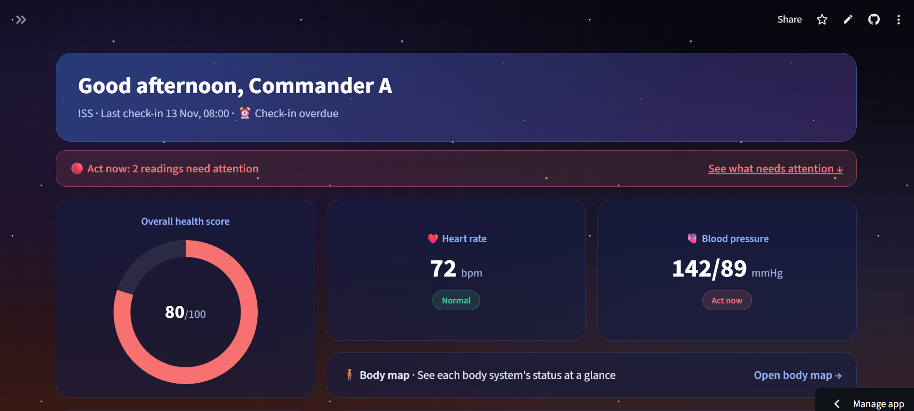
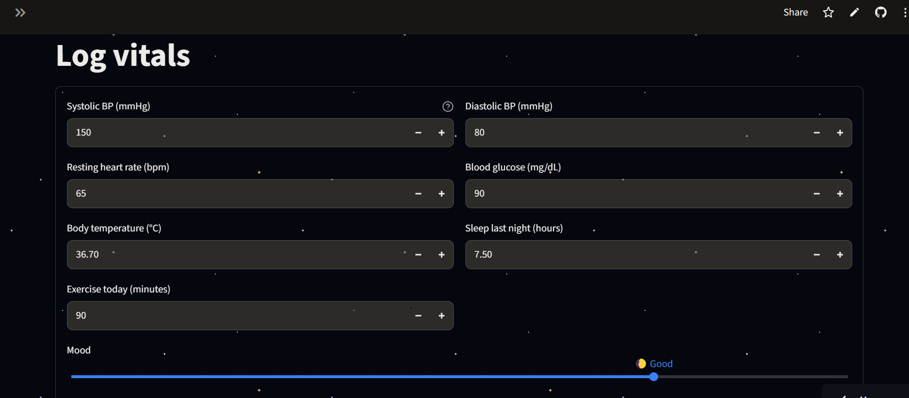
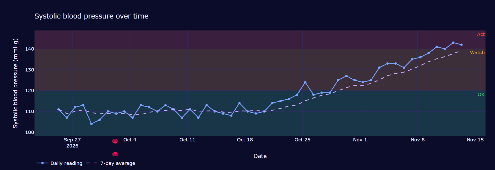
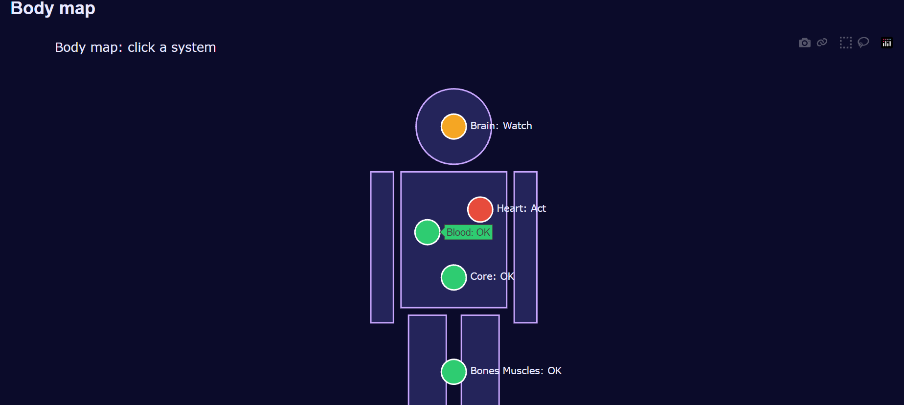
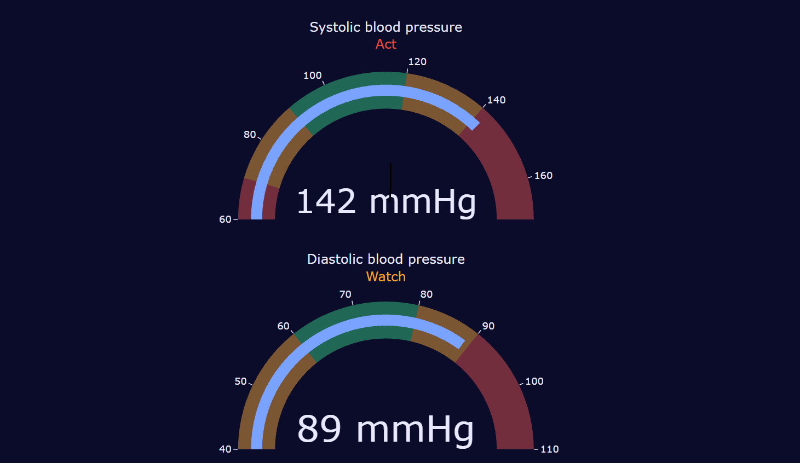

# NYX
### Astronaut Health Check-in
**A simple health check-in app that helps astronauts spot changes in their own health and decide what to do next.**

Built for the NASA Space Apps Challenge: *Create Health Monitoring Software for Astronauts on Space Missions.*

> **Decision support only, not a medical diagnosis.** This is a prototype for education and demonstration.

**App name:** NYX, the Astronaut Health Check-in
** Live app:** https://astronaut-health-checkin.streamlit.app/







---

## The problem

Long space missions expose astronauts to radiation, isolation and confinement, altered gravity and a closed environment. These can affect the heart, sleep, mood, bones and the immune system. On long missions, astronauts have to spot these changes in themselves, because help may be far away.

The challenge asks for software that gathers health indicators and lets astronauts evaluate and act on the status of their health. This project is our answer.

## What it does

- **Log Vitals:** an astronaut enters a daily check-in (blood pressure, heart rate, glucose, temperature, sleep, mood, stress, exercise).
- **Green / amber / red status:** every reading is checked against a range and shown as a traffic light (labelled OK, Watch and Act in the app).
- **Plain-language advice:** each status comes with three short sentences: what it means, what to do, and when to tell the crew doctor. The advice is different for "too low" and "too high".
- **Body Map:** a human figure. Hover over or click a body area to see the related reading and its status.
- **Trends:** charts over time with shaded green, amber and red bands.
- **Calm Break:** a quiet minute for astronauts. Click drifting stars if you like, or follow a breathing circle (in for 4 seconds, out for 6). There is no timer and no score. It is a relaxation break for education and demonstration, not medical advice.
- **Learn:** how to measure each indicator, and why it matters in space.

## How it works

1. An astronaut logs a reading, for example systolic blood pressure 145.
2. `core/assessment.py` compares it with the ranges in `core/thresholds.py` and returns green, amber or red.
3. `content/guidance.py` works out whether the reading is **below** or **above** the healthy range, and returns the matching advice.
4. The app shows the colour, the advice and the trend.

### The 9 indicators

`systolic_bp`, `diastolic_bp`, `heart_rate`, `blood_glucose`, `body_temp`, `sleep_hours`, `mood`, `stress`, `exercise_min`

For indicators that can go wrong in both directions (blood pressure, heart rate, glucose, temperature and sleep), amber and red each have a "low" and a "high" message. Mood, stress and exercise only go wrong one way.

### Why rules and not machine learning?

This was a deliberate choice:

- **Explainable.** An astronaut can see exactly why they got a red, which matters when the advice affects their health.
- **Predictable.** A fixed rule always gives the same answer for the same reading, so it can be checked.
- **Works with little data.** A real crew would have only a few weeks of readings, which is too little to train a model fairly.
- **Safe to demonstrate.** We do not claim to predict illness.


## How to run it

You need Python 3.10 or newer. The app was developed with Python 3.13.

```bash
git clone https://github.com/JoanneBabu01/astronaut_health_checkin.git
cd astronaut_health_checkin
python -m pip install -r requirements.txt
python -m streamlit run app.py
```

If you have several Python versions installed on Windows, you can pick one, for example: `python -V:3.13 -m streamlit run app.py`


## Project structure

| Path | What it holds | Owner |
|---|---|---|
| `app.py` | Home page | Rebecca |
| `pages/` | Log Vitals, Body Map, Trends, Mission Tasks, Learn | Latisha, Rebecca, Joanne |
| `core/data.py` | Loads and saves data | Rochelle |
| `core/thresholds.py` | Healthy ranges for each indicator | Rochelle |
| `core/assessment.py` | Turns a reading into green, amber or red | Rochelle |
| `core/charts.py` | All charts | Latisha |
| `content/guidance.py` | Advice text and how-to-measure steps | Joanne|
| `content/learn.py` | Space hazard to indicator table | Joanne |
| `data/` | Simulated log, real lab data and the data README | Rochelle |
| `scripts/` | Scripts that generate and prepare the data | Rochelle |
| `tests/` | Automated tests | Rochelle |
| `ui/` | Sidebar and backgrounds | Rebecca |
| `pages/6_Calm_Break.py` | Calm Break page (stars and breathing guide) | Rochelle |

## Limitations

- **The daily log is one pretend person.** Nothing in it shows how real astronauts behave. The real lab data is only four people on a short flight, so it cannot show long-mission trends.
- **Ranges are common adult reference ranges, not spaceflight limits.** Real flight medicine compares each astronaut with their own baseline, which this version does not do.
- **Not a medical device.** The app gives general guidance only.
- **Some hazards are not covered.** Space radiation and the closed, hostile environment are not tracked.
- **Environment-specific advice is future work.** The app records the environment (ISS, Transit, Lunar base or Mars base), but the advice is the same in every environment. Escalation on the Moon or Mars would need to account for delayed communication.
- **Bone and immune changes are not covered.** They need lab tests rather than daily check-ins, and are future work.
- Advice thresholds such as "3 days" are our own draft rules, not NASA rules.
- **Calm Break is a short break, not a treatment.** It has not been tested for any health effect.   

## Sources

- NASA, Risk of Cardiovascular Adaptations: https://www.nasa.gov/reference/risk-of-cardiovascular-adaptations
- NASA, Human Health and Performance spaceflight risks: https://www.nasa.gov/humans-in-space/hhc-spaceflight-risks/
- NASA, Human Factors and Behavioral Performance: https://www.nasa.gov/?p=630243
- NASA, Human Research Roadmap: https://humanresearchroadmap.nasa.gov/
- Review of NASA's top health risks: https://pmc.ncbi.nlm.nih.gov/articles/PMC7645687
- Astronaut sleep study: https://pmc.ncbi.nlm.nih.gov/articles/PMC8919197
- Blood pressure categories (American Heart Association guidelines, via Mayo Clinic): https://www.mayoclinic.org/diseases-conditions/high-blood-pressure/in-depth/blood-pressure/ART-20050982
- NASA Open Science Data Repository (OSDR): https://osdr.nasa.gov/

## Team

| Name | Role |
|---|---|
| Rebecca Dsouza | App and pages |
| Rochelle D'mello | Data and ranges |
| Latisha Dbritto | Charts and body map |
| Joanne Babu | Content, repo and documentation |

## Credits and SI use
Data from the NASA Open Science Data Repository, Inspiration4 studies OSD-569 and OSD-575. Details are in `data/README.md`.

Built with Python, Streamlit, pandas and Plotly. Super Intelligence (SI) tools were used during development; see "Use of SI tools" above for details. The team reviewed and tested all outputs.

## Data

The project uses two datasets. Full details are in [`data/README.md`](data/README.md).

| File | What it is | Real or simulated |
|---|---|---|
| `data/sample_crew_log.csv` | 50 days of daily check-ins for one pretend astronaut ("Commander A") | **Simulated** |
| `data/real_inspiration4_labs.csv` | Blood-test results from the four Inspiration4 crew members, at 7 timepoints | **Real** (NASA OSDR) |

The daily log (`data/sample_crew_log.csv`) is simulated, for one pretend astronaut; readings entered through Log Vitals are added to it. `data/real_inspiration4_labs.csv` holds real Inspiration4 blood tests from NASA's Open Science Data Repository (OSD-569 and OSD-575). It measures different things (blood tests, not daily vitals), so the two files are not combined, and the real data is a reference dataset that is not shown in the app. Details are in `data/README.md`.

The simulated log has a planted story so the charts show green, amber and red. The rising blood pressure is a **demo scenario**: NASA research reports that blood pressure in space usually stays the same or falls slightly. Mood goes from 1 (very low) to 5 (great), and stress goes from 1 (calm) to 5 (overwhelmed). Environments in the data are ISS, Transit, Lunar base and Mars base.

The real data comes from the Inspiration4 mission (four civilians, about three days in space): 4 crew members, 41 analytes, 7 timepoints, 1,034 measurements.

